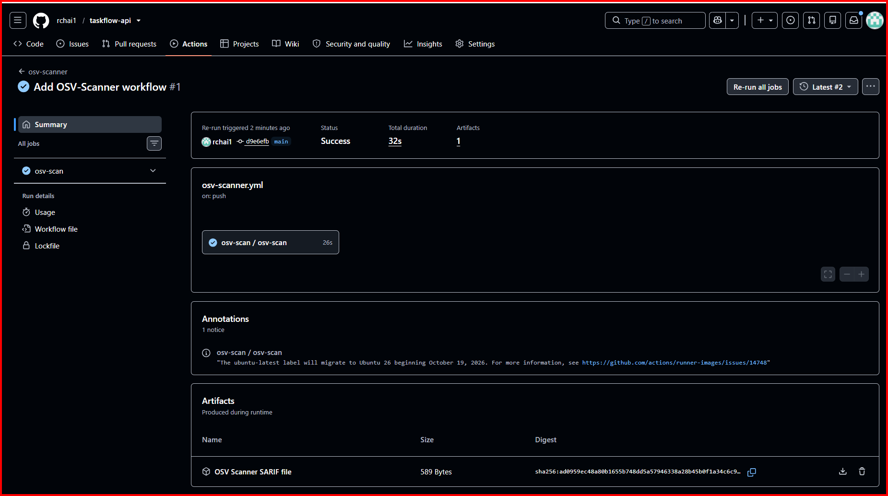
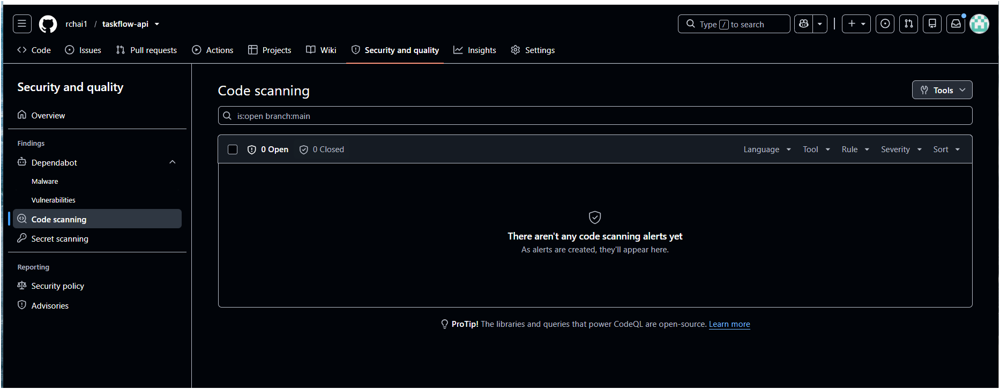
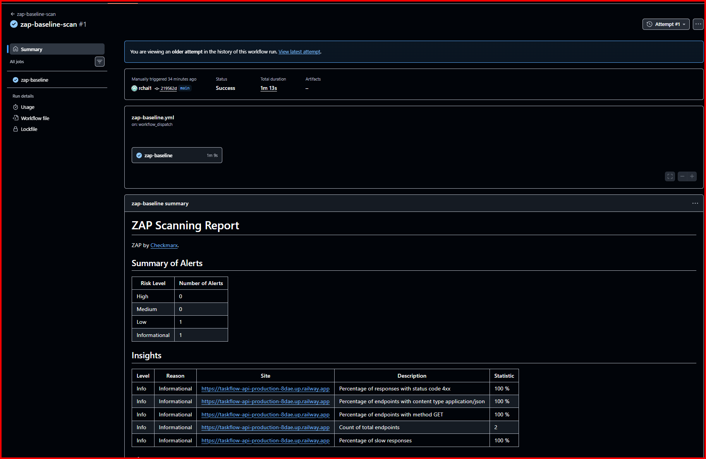
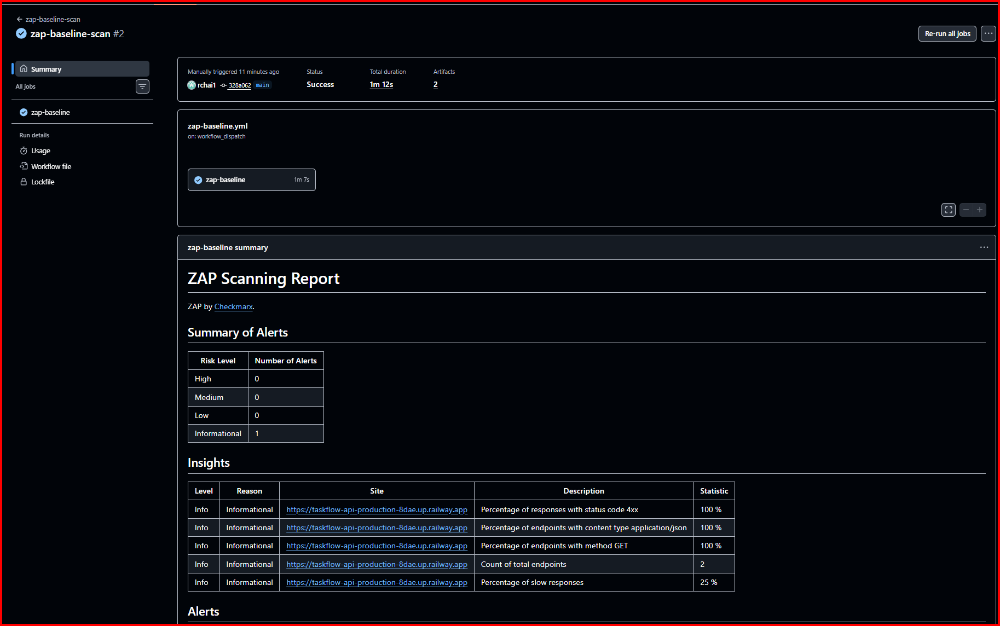

# TaskFlow API

## Module 4 Assignment Submission

TaskFlow API containerized with a multi-stage `Dockerfile` and deployed to Railway (built from this GitHub repo).

### Baseline and stretch goal

- **Baseline (Tasks 1-4):** commit [`33be495`](https://github.com/rchai1/taskflow-api/tree/33be49595a7f7bca44c14cb2aae19f08fc8ea788) "Add README with deployment details" (Dockerfile, Railway deploy, README, screenshots).
- **Stretch goal (Option 5: security checks):** the commits after it on `main`, from `d9e6efb` "Add OSV-Scanner workflow" onwards. `main` holds the latest code, and Railway deploys from it.

### Live application URL

https://taskflow-api-production-8dae.up.railway.app/api/tasks

> The API uses in-memory storage, so the task list is empty after each deploy or restart. Create a task with `POST /api/tasks` to see data.

### Screenshot: Railway dashboard


### Screenshot: Live application


### Errors and failures

```
Completed: Task 1, Task 2, Task 3, Task 4

Issues hit and fixed along the way:
- docker run: "Bind for 0.0.0.0:8080 failed: port is already allocated".
  An old container from an earlier lesson was using port 8080; stopped it with docker stop.
- git push: "GH007: Your push would publish a private email address".
  Set git user.email to my GitHub noreply address and amended the commit.
- Railway: "Free plan resource provision limit exceeded" when creating a new project.
  Deleted an old lesson project to free up resources.
```

### Stretch goal: Option 5 - Security checks

I added two non-blocking security checks ("watchdogs", Lesson 4.14) with GitHub Actions, fixed what they found, and checked the repo for secrets.

| Check           | Tool                 | Type | Runs                                    | Workflow                             |
| --------------- | -------------------- | ---- | --------------------------------------- | ------------------------------------ |
| Dependency scan | OSV-Scanner (Google) | SCA  | Every push to `main` + every Monday     | `.github/workflows/osv-scanner.yml`  |
| Live app scan   | OWASP ZAP baseline   | DAST | On demand after a deploy + every Monday | `.github/workflows/zap-baseline.yml` |

Both workflows pin the scanner and checkout actions by full commit SHA, not by tag (`actions/upload-artifact` is still on the `v7` tag), and use least-privilege `permissions`. The app URL is stored as a repository variable (`APP_URL`), not hard-coded.

> Note: the assignment mentions OWASP Dependency-Check. I used OSV-Scanner instead because it is the dependency (SCA) scanner taught in Lesson 4.14. It does the same job: checks every dependency in `pom.xml`, including transitive ones, against known vulnerabilities (OSV.dev, which includes the GitHub Advisory Database and NVD).

#### 1. Dependency scan (OSV-Scanner)

**Result: 0 known vulnerabilities.** The workflow passed and the Security tab shows no code scanning alerts. Nothing to fix, because the project uses a recent Spring Boot version (4.1.1). The weekly schedule will catch new vulnerabilities published later.





#### 2. Live app scan (OWASP ZAP baseline)

**First scan (before fix): 0 High, 0 Medium, 1 Low, 1 Informational**

(zap-baseline-scan run #1, attempt #1. Run #1 was later re-run after the fix, so its latest attempt shows the new result.)

| Alert                                    | Risk          | Meaning                                              |
| ---------------------------------------- | ------------- | ---------------------------------------------------- |
| Strict-Transport-Security Header Not Set | Low           | The app did not tell browsers to always use HTTPS    |
| Storable and Cacheable Content           | Informational | Responses could be stored by shared caches (proxies) |



**Fix:** I added `SecurityHeadersFilter` (`src/main/java/sg/edu/ntu/taskflow_api/config/SecurityHeadersFilter.java`), which adds two headers to every response:

- `Strict-Transport-Security: max-age=31536000; includeSubDomains` fixes the HSTS alert
- `Cache-Control: no-store` stops caches from storing API responses (task data can be user-specific)

**Second scan (after fix): 0 High, 0 Medium, 0 Low, 1 Informational**

(zap-baseline-scan run #2)

The HSTS alert is gone. The only remaining alert is **Non-Storable Content** (Informational). That is the expected result of `Cache-Control: no-store`: ZAP is just noting that responses are no longer cached. I left it as is on purpose, because not caching API data is the safer choice here.



**Limitation:** a ZAP baseline scan crawls links like a browser. This is a JSON API with no HTML pages, so ZAP only reached `/`, `/robots.txt` and `/sitemap.xml` (all 4xx). It checks the response headers the app sends, but it does not test the `/api/tasks` endpoints themselves. A full API scan with an OpenAPI definition would be the next step.

#### 3. Secrets check

- No passwords, tokens or API keys are committed to the repository (I checked the code and the git history).
- The OpenAI API key is read from an environment variable (`spring.ai.openai.api-key=${OPENAI_API_KEY}`). It is set in Railway's Variables, never in the code.
- `.gitignore` excludes build output (`target/`).

#### Problems I hit

- `git add .github` failed with "pathspec '.github' did not match any files". I had created the folder as `github` (no dot) in the wrong place. GitHub only runs workflows from `.github/workflows` inside the repo.
- The ZAP workflow doesn't run on push (only on demand or on Monday), so I started it with **Run workflow** in the Actions tab.

### How to run with Docker

```bash
docker build -t taskflow:latest .
docker run -p 8080:8080 taskflow:latest
curl http://localhost:8080/api/tasks
```

The `/api/tasks/summary` endpoint needs an OpenAI key, passed as an environment variable (`-e OPENAI_API_KEY=...` locally, or the Variables tab on Railway). It is never committed to the repo.

---

TaskFlow API is a task management REST API developed for the Module 3 End of Module Assignment.

The application is built with Java and Spring Boot and demonstrates RESTful API development, layered application architecture, dependency injection, in-memory data storage, and Spring AI integration.

## Technologies Used

- Java 21
- Spring Boot
- Spring Web MVC
- Spring AI
- OpenAI API
- Lombok
- Maven

## Application Structure

The application follows a layered architecture:

- `model` - Defines the Task data model
- `repository` - Handles in-memory task storage and CRUD operations
- `service` - Contains task-related business logic
- `controller` - Handles REST API requests and responses

## API Endpoints

| Method | Endpoint                   | Description                                           |
| ------ | -------------------------- | ----------------------------------------------------- |
| GET    | `/api/tasks`               | Get all tasks                                         |
| GET    | `/api/tasks/{id}`          | Get a task by ID                                      |
| POST   | `/api/tasks`               | Create a new task                                     |
| PUT    | `/api/tasks/{id}`          | Update an existing task                               |
| DELETE | `/api/tasks/{id}`          | Delete a task                                         |
| PUT    | `/api/tasks/{id}/complete` | Mark a task as completed                              |
| GET    | `/api/tasks/summary`       | Generate an AI summary of completed and pending tasks |

## Task Data

A task contains the following fields:

```json
{
  "id": 1,
  "title": "Complete Module 3 assignment",
  "description": "Finish and submit the TaskFlow API",
  "completed": false
}
```
