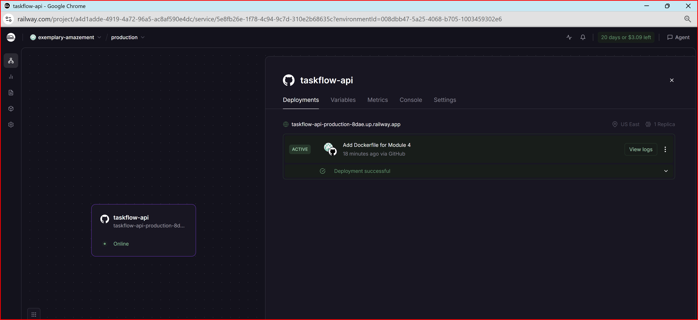
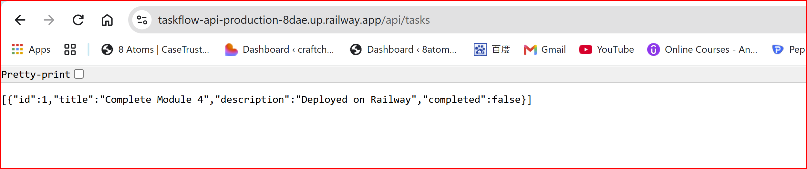

# TaskFlow API

## Module 4 Assignment Submission

TaskFlow API containerized with a multi-stage Dockerfile and deployed to Railway (built from this GitHub repo).

### Live application URL

https://taskflow-api-production-8dae.up.railway.app/api/tasks

> The API uses in-memory storage, so the task list is empty after each deploy or restart. Create a task with `POST /api/tasks` to see data.

### Screenshot: Railway dashboard



### Screenshot: Live application



### Errors and failures

```
Completed: Task 1, Task 2, Task 3, Task 4
Issues hit and fixed along the way:
-
docker run: "Bind for 0.0.0.0:8080 failed: port is already allocated".

An old container from an earlier lesson was using port 8080; stopped it with docker stop.
-
git push: "GH007: Your push would publish a private email address".

Set git user.email to my GitHub noreply address and amended the commit.
-
Railway: "Free plan resource provision limit exceeded" when creating a new project.

Deleted an old lesson project to free up resources.
```

### Stretch goal (optional)

```
Stretch goal: None
```

### How to run with Docker

```bash
docker build -t taskflow:latest .
docker run -p 8080:8080 taskflow:latest
curl http://localhost:8080/api/tasks
```

## The `/api/tasks/summary` endpoint needs an OpenAI key, passed as an environment variable (`-e OPENAI_API_KEY=...` locally, or the Variables tab on Railway). It is never committed to the repo.

TaskFlow API is a task management REST API developed for the Module 3 End of Module Assignment.
The application is built with Java and Spring Boot and demonstrates RESTful API development, layered application architecture, dependency injection, in-memory data storage, and Spring AI integration.

## Technologies Used

- Java 21
- Spring Boot
- Spring Web MVC
- Spring AI
- OpenAI API
- Lombok
- Maven

## Application Structure

The application follows a layered architecture:

- `model` – Defines the Task data model
- `repository` – Handles in-memory task storage and CRUD operations
- `service` – Contains task-related business logic
- `controller` – Handles REST API requests and responses

## API Endpoints

| Method | Endpoint                   | Description                                           |
| ------ | -------------------------- | ----------------------------------------------------- |
| GET    | `/api/tasks`               | Get all tasks                                         |
| GET    | `/api/tasks/{id}`          | Get a task by ID                                      |
| POST   | `/api/tasks`               | Create a new task                                     |
| PUT    | `/api/tasks/{id}`          | Update an existing task                               |
| DELETE | `/api/tasks/{id}`          | Delete a task                                         |
| PUT    | `/api/tasks/{id}/complete` | Mark a task as completed                              |
| GET    | `/api/tasks/summary`       | Generate an AI summary of completed and pending tasks |

## Task Data

A task contains the following fields:

```json
{
  "id": 1,

  "title": "Complete Module 3 assignment",

  "description": "Finish and submit the TaskFlow API",

  "completed": false
}
```
